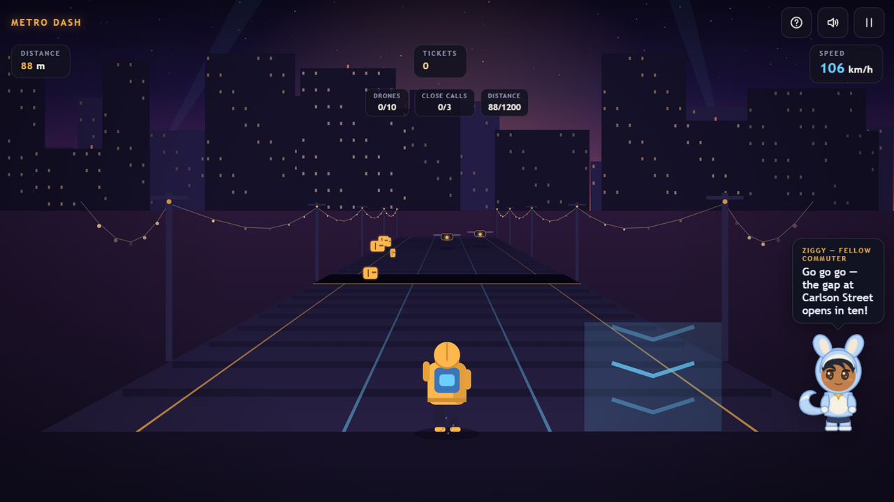

# METRO DASH

**The last metro left without you. Take the rooftops.** A three-lane endless runner across a dusk viaduct — jump the gaps, slide the gantries, dodge the maintenance drones, and clear three missions before the city wakes up.

[▶ Play Metro Dash](https://siddhant-pardeshi.github.io/metro-dash/) — free, no install, no login. Phones and desktops.



## The pitch

You missed the 23:40. Again. But the metro yards stretch to the horizon and the rooftops above them are a straight shot home — if your legs are. Three lanes of rails, crates, signal gantries and drones that hover exactly at torso height, all scrolling faster the further you go. Transit tickets line the route, boost pads hurl you through obstacles, and shaving past a drone by a coat-hem pays a "CLOSE!" bonus.

Each run deals three **missions** — collect a stack of tickets, bank a handful of near-misses, hit a distance mark. Clear all three for the perfect commute.

## Learn the city while you run

The rooftops are covered in signs — real ones and bait. Tickets sometimes glow from **verified billboards**; suspicious ones are decoys. And when a run ends, the **rooftop debrief** walks you through one scam pattern or HTTP status code from the night: the right call is worth +150. Every concept you master is tracked in the menu's **Concepts** codex.

## Controls

| Action | Keyboard | Touch |
| --- | --- | --- |
| Switch lane | `←` `→` / `A` `D` | Swipe left / right |
| Jump | `↑` / `W` / `Space` | Swipe up — or tap |
| Slide | `↓` / `S` | Swipe down |
| Pause | `Esc` / `P` | Pause icon |

- **Gantry signals** span all lanes at head height — slide, never jump.
- **Roof gaps** need an early jump; jumping late means a stumble, not a fall.
- **Oncoming trains** flash a warning on their lane a second before they arrive.
- Full guide: [docs/HOW_TO_PLAY.md](docs/HOW_TO_PLAY.md).

## Ziggy, your fellow commuter

The character in the corner is Ziggy — a regular on the roof deck. They greet you, react to cleared missions and near-misses with real animations, celebrate thousand-meter milestones, and nap when you pause. Hide or mute them in Settings. How the character rig works: [docs/mascot-guide.md](docs/mascot-guide.md).

## Accessibility & settings

Volume sliders and mute (`M`), quality tiers, reduced motion, camera-shake toggle, hideable mascot, fullscreen, keyboard-playable menus, touch targets ≥ 44px. Fully playable muted — every sound has a visual counterpart.

## Under the hood

One shared game kit, zero downloaded assets: the viaduct is a projected pseudo-3D track, the runner is drawn vector geometry, and the whole soundtrack — menu pads, the 126 BPM run groove, wind — is synthesized live with WebAudio. Progress and personal bests live in localStorage on your device.

- [docs/HOW_TO_PLAY.md](docs/HOW_TO_PLAY.md)
- [docs/mascot-guide.md](docs/mascot-guide.md)
- [docs/QA.md](docs/QA.md)

## Run it locally

```bash
python -m http.server 8000
# open http://localhost:8000
```

## License

MIT — see [LICENSE](LICENSE). All code, art, characters and music are original work.

Inspired by classic endless runners. Not affiliated with or endorsed by any studio or publisher.
